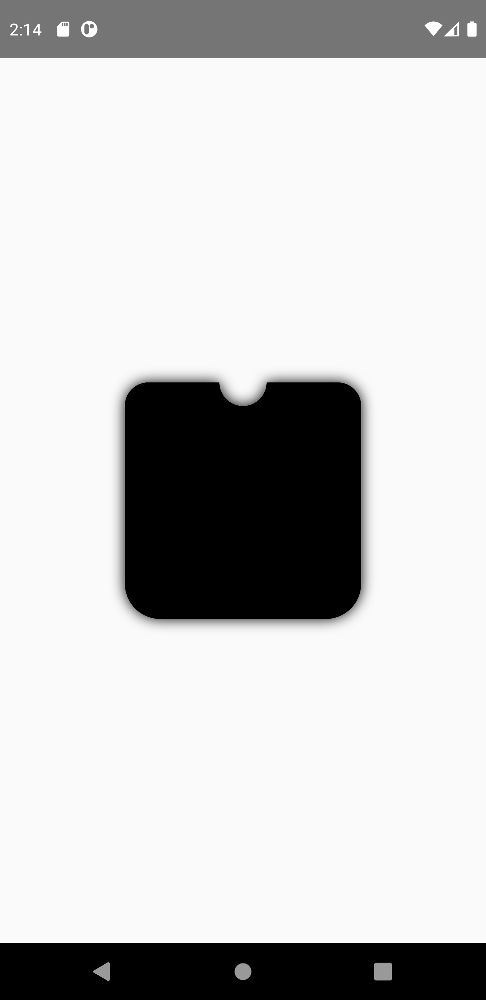
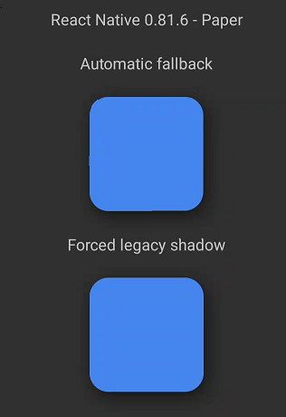
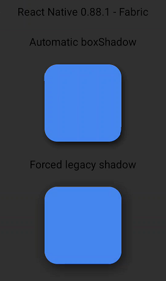

# React Native Drop Shadow

Beautiful cross-platform shadows, with automatic renderer selection and an
explicit legacy override.

[](https://www.npmjs.com/package/react-native-drop-shadow)
[](https://www.npmjs.com/package/react-native-drop-shadow)



`DropShadow` wraps your content using familiar React Native shadow styles.
On supported Fabric configurations, it converts those styles to native
`boxShadow`. Otherwise, it uses the Kotlin bitmap renderer on Android and
React Native's original shadow styles on iOS.
On Web, it uses React Native Web's CSS shadows without native modules or Fabric.

## Highlights

- **One component, two rendering paths:** automatic selection based on the
  mounted renderer, React Native version, platform, and shadow properties.
- **Legacy control:** `useLegacyShadow` keeps the Android bitmap renderer,
  including under the New Architecture.
- **View-compatible API:** pass children, view props, styles, and refs through
  the same component.
- **Native iOS styles:** no library-specific iOS native module or CocoaPods
  dependency.
- **TypeScript support:** includes public prop declarations, React Native
  sources, and CommonJS/ES module builds.

> **Compatibility notice:** React Native 0.61.5 and Android API 16 support is
> not ready. The current Android module requires API 21 and references a React
> Native event-dispatcher API unavailable in 0.61.5. See
> [verified compatibility](#verified-compatibility) before adopting a
> historical configuration.

## Supported platforms

| Platform | New Arch | Old Arch |
| --- | :---: | :---: |
| Android | ✅ | ✅ |
| iOS | ✅ | ✅ |
| Web (React Native Web) | ✅* | ✅* |

*Web support is independent of React Native's native architecture.

Platform support is subject to the version and OS constraints in
[verified compatibility](#verified-compatibility); iOS native validation remains
outstanding.

## Installation

```sh
npm install react-native-drop-shadow
```

Or:

```sh
yarn add react-native-drop-shadow
```

Rebuild your Android application after installation so React Native autolinking
can register the native fallback. The host application's own minimum Android
version still applies.

iOS does not need a pod installation specifically for this library. If you
are upgrading from an older version that included the native pod, rerun
`pod install` in your application to remove the previous pod integration.

## Quick start

```tsx
import React from 'react';
import { StyleSheet, Text, View } from 'react-native';
import DropShadow from 'react-native-drop-shadow';

export default function ShadowCard() {
  return (
    <DropShadow style={styles.shadow}>
      <View style={styles.card}>
        <Text>A little depth makes a difference.</Text>
      </View>
    </DropShadow>
  );
}

const styles = StyleSheet.create({
  shadow: {
    borderRadius: 20,
    shadowColor: '#000',
    shadowOffset: { width: 0, height: 4 },
    shadowOpacity: 0.2,
    shadowRadius: 8,
  },
  card: {
    borderRadius: 20,
    backgroundColor: '#fff',
    padding: 24,
  },
});
```

Set `borderRadius` on `DropShadow` itself for a rounded box shadow.
Rounding only the child does not round the wrapper's shadow.

## API

`DropShadowProps` extends React Native's `ViewProps`.

| Prop | Default | Description |
| --- | --- | --- |
| `useLegacyShadow` | `false` | Force Kotlin on Android; keep original shadow styles on iOS and Web. |
| `style` | - | Standard view styles, including legacy shadow styles or supported direct `boxShadow`. |
| `children` | - | Content rendered inside the selected underlying view. |

```tsx
import type { DropShadowProps } from 'react-native-drop-shadow';
```

### Choosing the renderer

| Configuration | Android | iOS |
| --- | --- | --- |
| RN 0.76+, Fabric, supported shadow | `boxShadow` on API 28+ | `boxShadow` |
| Paper, RN before 0.76, or unknown capabilities | Kotlin bitmap fallback | Original `View` shadows |
| Unsupported or unsafe legacy-style conversion | Kotlin bitmap fallback | Original `View` shadows |
| `useLegacyShadow={true}` | Kotlin bitmap fallback | Original `View` shadows |

Web does not use this native capability matrix: it renders CSS shadows through
React Native Web. Explicit `boxShadow` takes precedence; `useLegacyShadow`
preserves the original styles for React Native Web to handle.

These are renderer-selection rules, not proof that every host version builds.
Android inset box shadows require API 29+, while outset shadows require API 28+.
Read React Native's [boxShadow documentation](https://reactnative.dev/docs/view-style-props#boxshadow)
for the platform behavior.

Static `shadowColor`, `shadowOffset`, `shadowOpacity`, and `shadowRadius`
are converted when safe. A supported direct `boxShadow` takes precedence over
those legacy properties; the legacy shadow is not drawn a second time.
Unsupported direct box shadows are **not emulated** by the fallback.

### Keeping legacy shadows

Use the override for alpha-mask shadows, animations, or when retaining the
existing renderer is more important than switching automatically:

```tsx
<DropShadow useLegacyShadow style={styles.shadow}>
  <View style={styles.card} />
</DropShadow>
```

### Animated components

Create an animated wrapper using React Native's standard API:

```tsx
import { Animated } from 'react-native';
import DropShadow from 'react-native-drop-shadow';

const AnimatedDropShadow = Animated.createAnimatedComponent(DropShadow);

<AnimatedDropShadow useLegacyShadow style={animatedStyle}>
  {children}
</AnimatedDropShadow>;
```

`animatedStyle` and `children` are supplied by your application. Use
`useLegacyShadow` for animated shadows, including native-driver updates that
bypass JavaScript rendering. This library does not provide animation of
converted `boxShadow` values.

## Rendering considerations

- **Different geometry:** `boxShadow` follows the wrapper's border box. The
  Android bitmap fallback follows the alpha of its children. Transparent
  images and irregular shapes can therefore look different.
- **Initial native fallback:** detection happens after mounting so Paper and Fabric
  roots can coexist. Switching the Android renderer replaces the underlying
  view and can remount children, reset their state, or update refs. Keep
  `useLegacyShadow` enabled if your content must avoid that transition.
  Web has no mounted-renderer switch and preserves children across shadow updates.
- **Dynamic values:** platform colors and animated or invalid legacy shadow
  values that cannot be converted safely retain the platform fallback.
- **Clipping:** ancestors using `overflow: 'hidden'` can clip shadows. List
  layouts should leave enough space around shadowed items.
- **Bitmap cost:** large views, many simultaneous shadows, and frequent
  updates can increase memory usage and rendering cost on the Android fallback.

## Example applications

| Application | React Native | Architecture |
| --- | --- | --- |
| [Legacy](./examples/legacy/) | 0.81.6 | Paper |
| [Modern](./examples/modern/) | 0.88.1 | Fabric |
| [Web](./examples/web/) | React Native Web 0.21.4 | Browser / SSR, no Fabric |

The native applications compare automatic rendering with `useLegacyShadow`.
The Web host also covers explicit strings/arrays, refs, defaults, and hydration.

| Android / Paper | Android / Fabric |
| --- | --- |
|  |  |

Install workspace dependencies first:

```sh
yarn install --immutable
```

Start Metro, then run Android in a separate terminal:

```sh
yarn example start
yarn example android
```

`yarn example` targets the modern application. To test Paper, use
`yarn workspace DropShadowLegacy start` and
`yarn workspace DropShadowLegacy android`.

On macOS, install the selected application's pods before running iOS:

```sh
cd examples/modern/ios
pod install
cd ../../..
yarn example ios
```

## Verified compatibility

| Host | Android build | Android runtime | iOS |
| --- | --- | --- | --- |
| RN 0.81.6 / Paper | Debug and R8 release APKs passed | Launched on API 37; automatic and forced-legacy examples displayed | Not verified |
| RN 0.88.1 / Fabric | Debug and R8 release APKs passed | Launched on API 37; rounded automatic and forced-legacy shadows visually checked | CI targets this host; build/runtime not verified locally |
| RN 0.61.5 / Paper | Fixture and compatibility work deferred | Not verified | Not verified |
| Other versions and OS boundaries | Not verified as a complete native matrix | Not verified | Not verified |

JavaScript tests cover renderer selection, the RN 0.75/0.76 boundary,
Android API 27/28 and inset API 28/29 boundaries, direct shadows, conversion,
mixed roots, refs, and the override. Mocked tests do not replace native builds
or device validation.

The Web host passed six Chromium checks covering source, packed ESM, and
CommonJS consumers: computed CSS shadows/radius before JavaScript, hydration,
DOM refs, explicit precedence, defaults/numeric colors, and child-state
preservation. Packed declarations were typechecked. Other browser engines,
Web versions, and React Server Components integrations are not verified.

The modern Android example logged a nonfatal `ReactHost` window-focus soft
exception during an earlier device launch. Modern builds currently retain
the example template's AGP 9 Kotlin/new-DSL opt-outs; support with the AGP
defaults has not been verified.

## Android release builds: R8 / ProGuard

**No additional DropShadow keep rules are required.** The library automatically
supplies [consumer rules](./android/consumer-rules.pro) to preserve its
reflection-based shadow setters. R8-enabled release builds were verified on
RN 0.81.6/Paper and RN 0.88.1/Fabric, including device smoke tests on API 37.

For general release optimization and signing, follow the
[Android optimization guide](https://developer.android.com/topic/performance/app-optimization/enable-app-optimization)
and [React Native release guide](https://reactnative.dev/docs/signed-apk-android).

### RN 0.81.6 / Paper exception

The tested host requires this rule in the application's
`proguard-rules.pro` to prevent a React Native JNI initialization crash:

```proguard
-keep class com.facebook.react.devsupport.CxxInspectorPackagerConnection { *; }
```

This is a host-specific workaround, not a DropShadow requirement. It is included
in the [legacy example](./examples/legacy/android/app/proguard-rules.pro);
the tested RN 0.88.1/Fabric host does not need it.

## Development

Use **Yarn 3.6.1** and a Node version supported by **Builder Bob 0.44.1**:
`^22.22.2 || ^24.15.0 || >=26.0.0`. The contributor/CI Node version is in
[.nvmrc](./.nvmrc).

```sh
yarn install --immutable
yarn lint
yarn typecheck
yarn test --runInBand
yarn prepare
```

The development toolchain uses RN 0.88.1, React 19.3.0, and TypeScript 6.
All handwritten TypeScript library/example sources and tests use `.tsx`;
generated type declarations remain `.d.ts`.
These development versions are not imposed on registry-package consumers.
Git installations that execute `prepare` need a supported build-time Node
version; normal registry consumers do not need Builder Bob.

The project was compared with `create-react-native-library` 0.64.0. It retains
Yarn 3, CommonJS output, and the Android legacy view instead of adopting a
Fabric-only native scaffold. Historical compatibility remains unfinished.
CI builds both Android examples in debug and R8-enabled release configurations,
runs native regressions, and builds the modern iOS simulator application.

The Web verification workspace uses React Native Web 0.21.4 and Vite 8.3.8:

```sh
yarn prepare
yarn workspace DropShadowWeb typecheck
yarn workspace DropShadowWeb build
yarn workspace DropShadowWeb playwright install chromium
yarn workspace DropShadowWeb test
```

The Web test packs the library, typechecks its published declarations, builds
source/ESM/CommonJS consumers, server-renders without browser globals, and
checks hydration, computed CSS, refs, and child state in Chromium.
`yarn workspace DropShadowWeb start` opens the Web example through Vite.
CommonJS consumers use `require('react-native-drop-shadow').default`.

See [Contributing](./CONTRIBUTING.md) for development and pull-request guidance,
and [Security](./SECURITY.md) for vulnerability reporting.

## License and support

Released under the [MIT License](./LICENSE).

If this library helps your project, you can support its maintenance:

<a href="https://www.buymeacoffee.com/hoanglam104">
  
</a>
